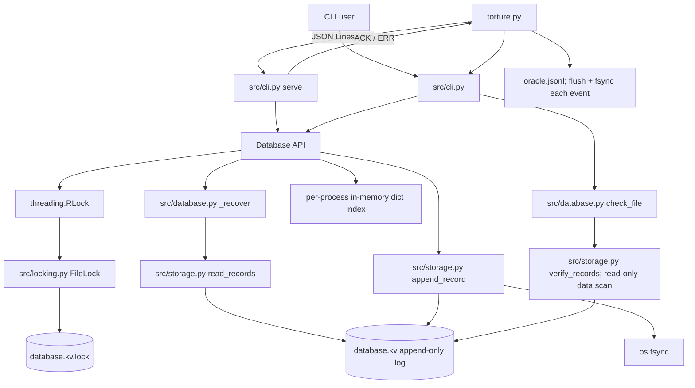

# Aid_Map Architecture (source audit)

This describes the implementation currently in this repository. It is not a
claim that the implementation satisfies the absent official hackathon
specification. The exact definitions of scenarios A1-A7, B1-B6, C1-C6, D1-D4,
E1-E5, and F1-F4 were not present; their mapping table is therefore explicitly
blocked below.

## Components and data flow

`src/locking.py` is the lock implementation. There is no root-level
`locking.py`. The `torture.py` oracle is separate from the database file.

## Files and records on disk

`Database(path)` creates the database if absent using `open(path, "ab")`, and
recovery creates/opens a `<path>.lock` sidecar. The database is a concatenated
record log. There is no global file header, index file, snapshot, compaction
manifest, or rename-based commit.

Every record has a **14-byte header** (`struct` format `>4sBBII`, big-endian):

| Offset | Size | Meaning |
|---:|---:|---|
| 0 | 4 | Magic bytes `KVDB` |
| 4 | 1 | Format version `1` |
| 5 | 1 | Record type: `1` PUT, `2` DELETE, `3` BATCH |
| 6 | 4 | Payload byte length |
| 10 | 4 | CRC-32 value |

The CRC is computed over `version byte + record-type byte + payload`. The magic
and payload-length header fields are **not** included in that CRC.

| Type | Payload layout | Total record size |
|---|---|---|
| PUT (`1`) | 2-byte key length, key bytes, value bytes | `14 + 2 + key length + value length` |
| DELETE (`2`) | 2-byte key length, key bytes | `14 + 2 + key length` |
| BATCH (`3`) | 4-byte operation count, followed by encoded operations | `14 + payload length` |

Inside a BATCH payload, each operation starts with a 1-byte type and 2-byte
key length followed by key bytes. A PUT then has a 4-byte value length and
value bytes; a DELETE has no value fields. Key lengths are 1-1024 bytes,
values are 0-1 MiB, and the engine accepts at most 10,000 batch operations.
The SERVE interface requires 1-10,000 batch operations. The underlying
`Database.batch([])` is a no-op returning `True`.

The lock sidecar is opened in append/read-write mode for normal use. If it is
empty, `FileLock` writes one zero byte before locking. Windows locks byte zero
with `msvcrt.locking`; POSIX uses `fcntl.flock`. Strict CHECK opens an existing
sidecar without creating it. Initializing that byte flushes the Python file
object but does not call `os.fsync` on the sidecar.

## Write, fsync, commit, and ACK ordering

### Database initialization

1. `Database.__init__` opens the data file in append-binary mode, creating an
   empty one if missing.
2. It acquires its process-local `RLock`, then the process `FileLock`.
3. `_recover()` reads/replays records. An incomplete final record may be
   truncated and fsynced here.
4. Initialization releases locks and returns. There is no directory fsync
   after creating the data or lock file.

### PUT

1. `Database.put` encodes and validates the key/value before locking.
2. It acquires the `RLock` and process lock, then `_recover()` refreshes the
   process-local index from the file.
3. `append_record` creates the full encoded record in memory, opens with
   `O_APPEND`, loops over `os.write` until all bytes are written, and calls
   `os.fsync(fd)`.
4. Only after `append_record` returns does `Database.put` update its index and
   return; the process lock and `RLock` are then released.
5. SERVE writes `ACK <id>\n` and flushes stdout only after the method returns.

DELETE follows the same persistence sequence only when the key is present. If
absent, `Database.delete` returns `False` without appending; SERVE currently
ACKs either successful return value.

### BATCH

1. The engine encodes/validates the full operation list before locking.
2. It acquires both locks and refreshes the index with `_recover()`.
3. It appends **one** BATCH record, writes all record bytes, then fsyncs once.
4. Only after append/fsync returns does the engine decode the batch payload and
   apply its operations to the in-memory index; it returns `True`.
5. SERVE emits one ACK after that return.

There is no `rename`, `os.replace`, temp database, or second commit file in
these paths. ACK follows the method's fsync call, but the code does not fsync
the containing directory when files are created and cannot promise behavior of
every filesystem, controller, or hardware cache.

## Locking, index, recovery, CHECK, and missing features

- Each `Database` instance has a `threading.RLock`; operations also acquire a
  sidecar process lock. Reads, writes, key count, and items all call `_recover`
  while locked, rebuilding the index from the log.
- `_recover()` uses `read_records()` in `src/storage.py`. Incomplete trailing
  header or payload: truncate to the beginning of that record, flush and
  fsync, then stop replaying. Bad magic/version/checksum raises instead of
  truncating that record.
- `Database.check_file()` requires an existing database and lock file, holds
  the existing lock, calls `verify_records()` (read-only database open), and
  validates record payloads. It does not construct a `Database`, create a
  missing database, or repair the database tail.
- The in-memory index is a Python dictionary, not persisted independently.
- No compaction, snapshotting, `--max-bytes`, bounded disk allocator, or
  database-level disk-full prevention mechanism was found.

## Official 32-scenario mapping — blocked pending source

Only the IDs were supplied in the task. It would be misleading to infer a
scenario's exact crash point or expected disk state from its letter/number.
Provide the official scenario text before filling this table.

| ID | Required disk state | Mechanism in current code | Code file/function | Verification evidence |
|---|---|---|---|---|
| A1 | NOT VERIFIED — definition unavailable | NOT VERIFIED — mapping unavailable | BLOCKED | Official A1 text required |
| A2 | NOT VERIFIED — definition unavailable | NOT VERIFIED — mapping unavailable | BLOCKED | Official A2 text required |
| A3 | NOT VERIFIED — definition unavailable | NOT VERIFIED — mapping unavailable | BLOCKED | Official A3 text required |
| A4 | NOT VERIFIED — definition unavailable | NOT VERIFIED — mapping unavailable | BLOCKED | Official A4 text required |
| A5 | NOT VERIFIED — definition unavailable | NOT VERIFIED — mapping unavailable | BLOCKED | Official A5 text required |
| A6 | NOT VERIFIED — definition unavailable | NOT VERIFIED — mapping unavailable | BLOCKED | Official A6 text required |
| A7 | NOT VERIFIED — definition unavailable | NOT VERIFIED — mapping unavailable | BLOCKED | Official A7 text required |
| B1 | NOT VERIFIED — definition unavailable | NOT VERIFIED — mapping unavailable | BLOCKED | Official B1 text required |
| B2 | NOT VERIFIED — definition unavailable | NOT VERIFIED — mapping unavailable | BLOCKED | Official B2 text required |
| B3 | NOT VERIFIED — definition unavailable | NOT VERIFIED — mapping unavailable | BLOCKED | Official B3 text required |
| B4 | NOT VERIFIED — definition unavailable | NOT VERIFIED — mapping unavailable | BLOCKED | Official B4 text required |
| B5 | NOT VERIFIED — definition unavailable | NOT VERIFIED — mapping unavailable | BLOCKED | Official B5 text required |
| B6 | NOT VERIFIED — definition unavailable | NOT VERIFIED — mapping unavailable | BLOCKED | Official B6 text required |
| C1 | NOT VERIFIED — definition unavailable | NOT VERIFIED — mapping unavailable | BLOCKED | Official C1 text required |
| C2 | NOT VERIFIED — definition unavailable | NOT VERIFIED — mapping unavailable | BLOCKED | Official C2 text required |
| C3 | NOT VERIFIED — definition unavailable | NOT VERIFIED — mapping unavailable | BLOCKED | Official C3 text required |
| C4 | NOT VERIFIED — definition unavailable | NOT VERIFIED — mapping unavailable | BLOCKED | Official C4 text required |
| C5 | NOT VERIFIED — definition unavailable | NOT VERIFIED — mapping unavailable | BLOCKED | Official C5 text required |
| C6 | NOT VERIFIED — definition unavailable | NOT VERIFIED — mapping unavailable | BLOCKED | Official C6 text required |
| D1 | NOT VERIFIED — definition unavailable | NOT VERIFIED — mapping unavailable | BLOCKED | Official D1 text required |
| D2 | NOT VERIFIED — definition unavailable | NOT VERIFIED — mapping unavailable | BLOCKED | Official D2 text required |
| D3 | NOT VERIFIED — definition unavailable | NOT VERIFIED — mapping unavailable | BLOCKED | Official D3 text required |
| D4 | NOT VERIFIED — definition unavailable | NOT VERIFIED — mapping unavailable | BLOCKED | Official D4 text required |
| E1 | NOT VERIFIED — definition unavailable | NOT VERIFIED — mapping unavailable | BLOCKED | Official E1 text required |
| E2 | NOT VERIFIED — definition unavailable | NOT VERIFIED — mapping unavailable | BLOCKED | Official E2 text required |
| E3 | NOT VERIFIED — definition unavailable | NOT VERIFIED — mapping unavailable | BLOCKED | Official E3 text required |
| E4 | NOT VERIFIED — definition unavailable | NOT VERIFIED — mapping unavailable | BLOCKED | Official E4 text required |
| E5 | NOT VERIFIED — definition unavailable | NOT VERIFIED — mapping unavailable | BLOCKED | Official E5 text required |
| F1 | NOT VERIFIED — definition unavailable | NOT VERIFIED — mapping unavailable | BLOCKED | Official F1 text required |
| F2 | NOT VERIFIED — definition unavailable | NOT VERIFIED — mapping unavailable | BLOCKED | Official F2 text required |
| F3 | NOT VERIFIED — definition unavailable | NOT VERIFIED — mapping unavailable | BLOCKED | Official F3 text required |
| F4 | NOT VERIFIED — definition unavailable | NOT VERIFIED — mapping unavailable | BLOCKED | Official F4 text required |

## Guarantee arguments and limits

### Durability

For a successful non-empty PUT, present-key DELETE, or BATCH, the implementation
calls `os.fsync` on the database file before the method returns; SERVE sends
ACK after method return. This is a code-path argument, not proof of persistence
across all power-loss, filesystem, or hardware-cache failures. File/directory
creation is not followed by directory fsync. A failed operation without ACK
may nevertheless have left a complete record on disk.

### Batch atomicity

A batch is represented by one BATCH log record. Recovery only applies complete,
checksum-valid records, so an incomplete trailing record is truncated as a
whole. The engine applies batch members after the complete append/fsync. This
supports all-or-none recovery for torn tail records under the implemented
format. It is not a proof against arbitrary corruption or bugs, and final-state
tests cannot detect every partially applied batch later masked by subsequent
operations.

### Recoverability

Startup replays the log and repairs only an incomplete trailing header or
payload. Strict CHECK instead rejects incomplete tails without repairing the
database. Invalid magic/version, checksum mismatch, or invalid operation
payload raises; no automated salvage of committed corruption is implemented.
The length field is not covered by the CRC, so a corrupted length may produce
an error or an incomplete-tail interpretation; no format change was made.

## Source/test references

Primary files: `src/database.py`, `src/storage.py`, `src/locking.py`,
`src/cli.py`, and `torture.py`.

Relevant tests present in `tests/`: `test_atomic_batch.py`,
`test_check_readonly.py`, `test_recovery.py`, `test_locking.py`,
`test_multiprocessing.py`, `test_serve.py`, `test_torture_harness.py`, and
`test_torture_scenarios.py`. Their presence is not a test result; consult the
checklist for validation status.
