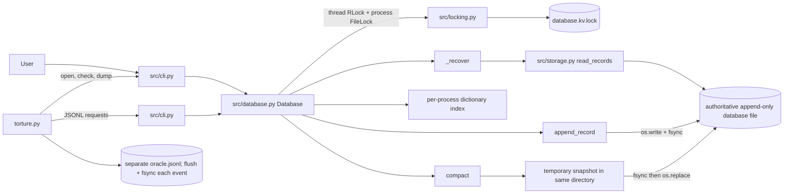

# Aid_Map Architecture and Crash Evidence

This document describes the current implementation in `src/`, the torture
harness, and the evidence available for each official scenario. A passing
test or benchmark is evidence for its stated scope only; it is not a blanket
power-loss guarantee.

## Architecture

### Persisted format

There is no global database header or separately persisted index. The
authoritative data is a concatenated stream of records. Each record has a
14-byte big-endian header (`>4sBBII`):

| Offset | Bytes | Field |
|---:|---:|---|
| 0 | 4 | Magic: `KVDB` |
| 4 | 1 | Format version: `1` |
| 5 | 1 | Type: PUT `1`, DELETE `2`, BATCH `3` |
| 6 | 4 | Payload length |
| 10 | 4 | CRC-32 over version + type + payload |

The CRC does not cover the magic or payload-length field.

| Type | Payload | Total bytes |
|---|---|---|
| PUT | 2-byte key length, key, value (remaining payload) | `14 + 2 + key bytes + value bytes` |
| DELETE | 2-byte key length, key | `14 + 2 + key bytes` |
| BATCH | 4-byte operation count, followed by typed operations | `14 + payload bytes` |

Each BATCH member is a 1-byte type and 2-byte key length, followed by key
bytes. A PUT member additionally has a 4-byte value length and value bytes;
DELETE has no value fields. Keys are 1-1,024 bytes, values 0-1 MiB, and
batches contain at most 10,000 operations. A batch is one record, and members
apply in supplied order; the last operation on a repeated key determines its
final presence/value.

The `.lock` sidecar is synchronization metadata, not a second data store.
Compaction temporarily creates a snapshot file in the same directory, then
replaces the authoritative path. During compaction the old database remains
authoritative until replacement; after replacement the new file is
authoritative.

### Write, ACK, and batch ordering

For a non-empty successful write:

1. Encode and validate the operation.
2. Acquire the instance `threading.RLock`, then the sidecar `FileLock`.
3. Replay the current file to refresh the in-memory index.
4. Encode one record and append with `O_APPEND`, looping over `os.write`.
5. Call `os.fsync` on the database file.
6. Update the in-memory index and return from the database method.
7. Release locks; for SERVE, write and flush `ACK <id>\n`.

DELETE of an absent key returns false without appending; SERVE ACKs a
successful method return, including that no-op. A BATCH is validated and
encoded before locking, appended as one record, fsynced once, and only then
applied to the in-memory index. Recovery either reads and applies the complete
valid record or truncates an incomplete final record as a whole.

There is **no separate batch commit-marker record**. A complete CRC-valid
BATCH can be replayed even if the process died before the caller observed an
ACK. This is compatible with whole-record all-or-none replay, but it does not
implement a specification requiring “all bytes before a later commit marker
remain invisible.”

### Locking, recovery, size limits, and compaction

- Each `Database` instance serializes threads with `threading.RLock`.
  Operations also use `FileLock` on `<database path>.lock`: Windows uses
  `msvcrt.locking`, POSIX uses `fcntl.flock`.
- The in-memory dictionary is rebuilt from the record log on open and
  refreshed while locked on subsequent operations.
- `read_records()` truncates an incomplete trailing header or payload to that
  record's starting offset, flushes, and fsyncs. Invalid magic/version,
  checksum, or decoded operation raises; it is not silently discarded.
- `check` uses `Database.check_file()` and `verify_records()` for a strict,
  non-repairing scan. It requires the existing lock sidecar. `open`, ordinary
  API reads, and `dump` construct a `Database` and can therefore repair a
  torn tail during recovery.
- `max_bytes` is an instance option on `Database` (the CLI exposes it on the
  `open` command only). Appends compare current size plus full record size
  under the process lock before writing. If an OS write fails after a partial
  append, storage attempts `ftruncate` to the old size and fsyncs the rollback.
  If rollback also fails, the raised error reports both failures. The cap is
  not stored in the file and must be passed again to every new instance.
- `compact()` takes the same locks, replays the log, writes live PUT snapshots
  to a temporary file in the database directory, flushes/fsyncs it, then calls
  `os.replace`. On non-Windows systems it fsyncs the containing directory
  after replacement. Windows has no directory-fsync step here. The configured
  `max_bytes` cap is not applied to the temporary compaction snapshot; ENOSPC
  before replacement leaves the old database path in place. Orphan temp-file
  cleanup is best effort, not a complete startup scavenger.

## Official A1-F4 scenario evidence matrix

“Verified” means the current suite, mode, or supplied recorded measurement
exercised the stated condition. “Partially verified” means related behavior
or source ordering is covered but a specific official crash point or
acceptance condition is not. “Unverified” means no adequate matching
demonstration exists. The performance measurements below are team-reported;
raw console logs are not checked into the repository.

| ID | Official scenario and expected after restart | Disk state, recovery, and code | Test evidence and status |
|---|---|---|---|
| A1 | Kill before any bytes of a put reach the file. Key absent or previous value. | No new record bytes; prior log replays. `Database.put`, `append_record`. | No kill-at-zero-byte test. **UNVERIFIED**. |
| A2 | Kill after some bytes of the record are written, but not all. Torn bytes ignored; key absent or previous value. | Incomplete tail is truncated to record start and fsynced. `append_record`, `_read_records`. | `test_force_kill_during_partial_put_recovers_previous_value`. **VERIFIED**. |
| A3 | Kill after record fully written, before fsync. Either old or new state; no corruption. | Complete valid record may be replayed; partial/invalid tail is rejected/repaired. No durability claim before fsync. | No deterministic full-write/pre-fsync kill. **UNVERIFIED**. |
| A4 | Kill after fsync returns, before put returns success. New value present. | File fsync precedes index update and method return; recovery replays the record. `append_record`, `Database.put`. | Ordering is established by source, not a kill hook at this exact boundary. **PARTIALLY VERIFIED**. |
| A5 | Kill immediately after put returns success. New value present. | Successful PUT has passed file fsync before return; replay restores it. | `test_force_kill_immediately_after_put_ack_preserves_value`; `test_put_ack_is_durable_and_value_survives_restart`. **VERIFIED**. |
| A6 | Kill during delete. Old value present or key absent; never corrupted. | A short tail is removed as one DELETE record; a complete valid DELETE is replayed. `Database.delete`, `read_records`. | No deterministic kill during DELETE append. **PARTIALLY VERIFIED**. |
| A7 | Kill during a 1 MB put. Same guarantees as A1–A5. | Same PUT record path; incomplete record is discarded as a whole. | 1 MiB restart test and `large-value` generation cover size/ordinary recovery, not every A1-A5 kill boundary. **PARTIALLY VERIFIED**. |
| B1 | Kill after 3 of 10 operations are written. None of the 10 visible. | All ten members are bytes of one BATCH record; incomplete tail is truncated whole. `Database.batch`, `_read_records`. | Partial two-operation batch kill test, not exactly 3/10. **PARTIALLY VERIFIED**. |
| B2 | Kill after all 10 are written but before commit marker. None visible. | There is no separate commit marker. A full valid BATCH record is replayed, so the required marker boundary is not represented. | Protocol mismatch; no marker test. **UNVERIFIED / REQUIREMENT GAP**. |
| B3 | Kill after commit marker, before fsync. All or none. | There is no separate marker; one complete record is replayed whole, incomplete record is discarded whole. | Partial batch kill coverage exists; no marker-to-fsync kill. **PARTIALLY VERIFIED**. |
| B4 | Kill after batch returns success. All visible. | BATCH is fsynced before in-memory apply/return; replay applies all members. | Batch API/ACK tests and 10,000-op ordinary reopen test; no exact post-return forced-kill hook. **PARTIALLY VERIFIED**. |
| B5 | Batch puts and deletes the same key. Ordering is defined in README and honored. | Members are applied sequentially; README now documents last-operation-wins. `Database._apply_operations`, `read_batch_operations`. | Code path is clear; no focused same-key order test. **PARTIALLY VERIFIED**. |
| B6 | Kill halfway through a 10,000-operation batch. None visible; recovery under 2 seconds. | One BATCH record means a torn record is discarded whole. | Exact 10,000-op/10,001 rejection tests and mode generation exist; no timed mid-write kill run at 10,000 ops. **PARTIALLY VERIFIED**. |
| C1 | Kill during log replay in open(). Next open succeeds with correct state. | Replay rebuilds only an in-memory index; next open replays from the file again. `Database._recover`. | Current validation: seed `12345`, 3/3 recovery-crash iterations passed in 1.64 s; each pause/kill and subsequent open/CHECK/DUMP/oracle verification was confirmed. No standalone log file is checked in. **VERIFIED**. |
| C2 | Kill during torn-tail repair. Next open succeeds. | Truncate, flush, fsync are retried by a subsequent open if interrupted. `_read_records`. | Normal tail repair is tested; no kill at truncate/fsync sub-boundary. **PARTIALLY VERIFIED**. |
| C3 | Kill during compaction before replacement. Old file remains authoritative. | Snapshot is written to a same-directory temp; old path is not replaced until `os.replace`. | `test_kill_before_compaction_replace_keeps_original_database`; snapshot-write pause test. **VERIFIED**. |
| C4 | Kill during compaction rename/swap. Exactly one complete state is authoritative. | Replacement uses `os.replace`; directory fsync follows only on non-Windows. | Before- and after-replacement tests exist, but no kill inside the replacement syscall and Windows power-loss semantics are unproven. **PARTIALLY VERIFIED**. |
| C5 | Kill after swap before cleanup. Data intact; temporary files cleaned or ignored. | After replace, target is the complete snapshot; the old temp name has moved. Recovery reads only target. | After-replacement kill test verifies data; generic orphan cleanup is not promised. **PARTIALLY VERIFIED**. |
| C6 | Kill during close(). Same guarantees as any other kill. | `Database.close()` only marks the instance closed; prior completed appends already fsynced. | No kill-during-close test. **PARTIALLY VERIFIED**. |
| D1 | Two writers put different keys, then kill. All ACKed puts survive. | File lock serializes appends and each ACK follows fsync. | `test_open_handles_see_sequential_commits_after_forced_kill`. **VERIFIED**. |
| D2 | Two writers put the same key, then kill. Value is one complete value actually written. | Lock serializes whole records; a valid PUT is not bytewise merged with another. | `test_barrier_concurrent_writes_and_same_key_serialized_order`. **VERIFIED**. |
| D3 | Long batch concurrent with individual puts, then kill. Batch atomic; ACKed individual puts survive. | Same process lock serializes each one-record batch and PUT. | Separate concurrency and atomic-batch tests cover parts, not the combined long-batch kill. **PARTIALLY VERIFIED**. |
| D4 | GET during batch. Reader sees before or after, never partial. | GET acquires the sidecar lock and replays complete records. | No focused overlapping GET/large-batch test. **PARTIALLY VERIFIED**. |
| E1 | File cap reached during PUT. Clean error; old data readable. | Full encoded size is checked before write; partial OS failures attempt rollback. | `test_put_exceeding_limit_fails_without_losing_existing_data`; ENOSPC rollback tests. **VERIFIED** for configured cap and injected errors. |
| E2 | File cap reached halfway through batch. Error; none visible. | Size limit rejects the whole record; partial ENOSPC rolls the file back to its starting size. | `test_batch_exceeding_limit_is_rejected_atomically`; `test_failed_batch_enospc_is_absent_after_reopen`. **VERIFIED** for limit/fault-injection behavior. |
| E3 | Kill after file cap reached. Previously ACKed data survives. | Failed append does not ACK; earlier ACKed records were fsynced. | Limit/ACK error tests cover preservation, but not a kill after the cap error. **PARTIALLY VERIFIED**. |
| E4 | File cap reached during compaction. No data loss; database opens. | Snapshot writes to a temp and replaces only on success; cap is not applied to compaction. ENOSPC before replace should preserve old path. | Compaction fsync/replace failure tests preserve old data; no explicit cap/ENOSPC compaction test. **PARTIALLY VERIFIED**. |
| E5 | Deletes and compaction free space. New writes succeed without manual intervention. | Compaction emits only live PUT records; an empty live set becomes an empty log. | Churn benchmark reports 1M PUT + 1M DELETE, 51,003,600 → 0 bytes, reopen passed; no post-compaction write in that run. **PARTIALLY VERIFIED**. |
| F1 | 500 random kills and restarts. Invariant holds every time. | Basic harness uses two writers, forced process kill, and independent fsynced oracle verification. | Reported run: seed `67890`, 500 PASS, 0 FAIL/INCONCLUSIVE/ERROR, 194.24 seconds. **VERIFIED** (reported result; transcript not checked in). |
| F2 | Repeated kills during recovery. Recovery remains idempotent. | Next open rebuilds from the same authoritative file; tail repair is truncate+fsync. | `recovery-crash` repeats one replay kill per isolated iteration; no repeated kill sequence on the same recovery/database. **PARTIALLY VERIFIED**. |
| F3 | 1,000,000 keys, kill, reopen. Recovery under 2 seconds; ACKed keys present. | Linear record replay rebuilds the dict. | Million-key reopen benchmark: 0.809168 s, 1,000,000 keys and samples correct; benchmark is a clean reopen, not kill during loading. **PARTIALLY VERIFIED**. |
| F4 | Truncate database by one byte manually. Open succeeds; at most last unACKed record lost. | Short tail is discarded to the beginning of its record; if that was an ACKed final record, it can also be lost. | Normal incomplete-tail append repair test exists, not this exact truncation. **UNVERIFIED; possible acceptance conflict**. |

## Guarantee arguments and limits

**Durability:** An ACK from SERVE follows the database method return; a
successful non-empty append calls file `os.fsync` before that return. The
code-path ordering supports ACK durability under the tested process-kill
model. It does not prove storage-controller behavior during power loss, and
new file/directory entries are not directory-fsynced on creation.

**Batch atomicity:** A BATCH is one checksummed log record and the index applies
its members only after append/fsync. Recovery discards an incomplete record
whole. This is the implemented all-or-none basis; no separate commit marker
exists, and arbitrary corruption or rollback failure is outside the proof.

**Recoverability:** Open replays complete records and truncates an incomplete
tail; the new recovery-crash mode confirms a kill during record replay followed
by successful re-open and oracle verification. Invalid headers/checksums are
errors, not auto-repaired. Strict CHECK is read-only and intentionally does
not repair.

## Remaining high-risk gaps

- No deterministic evidence for A1, A3, A4, A6, C2, C6, or D4 exact crash or
  overlap boundaries; F4 may conflict with the ACK-retention requirement.
- B2's separate commit-marker expectation is not implemented.
- `os.replace` plus directory fsync has a platform-specific durability gap on
  Windows; process-kill tests do not emulate sudden power loss.
- The raw benchmark console transcripts and original prompts from all
  teammates are not currently in the repository.
