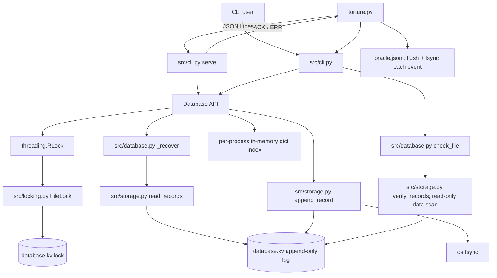

# Aid_Map Architecture (source audit)

This describes the implementation currently in this repository against the
official scenario descriptions supplied in the conversation from Problem
Statement Section 5, pages 5-8. `OFFICIAL_SCENARIOS.md` was not found in the
workspace. The document does not claim unsupported behavior is implemented or
verified. Test names identify repository evidence; tests were not run as part
of this documentation update.

## Components and data flow

`src/locking.py` is the lock implementation. There is no root-level
`locking.py`. The `torture.py` oracle is separate from the database file.

## Files and records on disk

`Database(path)` creates the database if absent using `open(path, "ab")`, and
recovery creates/opens a `<path>.lock` sidecar. The database is a concatenated
record log. There is no global file header, index file, snapshot, compaction
manifest, or rename-based commit.

Every record has a **14-byte header** (`struct` format `>4sBBII`, big-endian):

| Offset | Size | Meaning |
|---:|---:|---|
| 0 | 4 | Magic bytes `KVDB` |
| 4 | 1 | Format version `1` |
| 5 | 1 | Record type: `1` PUT, `2` DELETE, `3` BATCH |
| 6 | 4 | Payload byte length |
| 10 | 4 | CRC-32 value |

The CRC is computed over `version byte + record-type byte + payload`. The magic
and payload-length header fields are **not** included in that CRC.

| Type | Payload layout | Total record size |
|---|---|---|
| PUT (`1`) | 2-byte key length, key bytes, value bytes | `14 + 2 + key length + value length` |
| DELETE (`2`) | 2-byte key length, key bytes | `14 + 2 + key length` |
| BATCH (`3`) | 4-byte operation count, followed by encoded operations | `14 + payload length` |

Inside a BATCH payload, each operation starts with a 1-byte type and 2-byte
key length followed by key bytes. A PUT then has a 4-byte value length and
value bytes; a DELETE has no value fields. Key lengths are 1-1024 bytes,
values are 0-1 MiB, and the engine accepts at most 10,000 batch operations.
The SERVE interface requires 1-10,000 batch operations. The underlying
`Database.batch([])` is a no-op returning `True`.

The lock sidecar is opened in append/read-write mode for normal use. If it is
empty, `FileLock` writes one zero byte before locking. Windows locks byte zero
with `msvcrt.locking`; POSIX uses `fcntl.flock`. Strict CHECK opens an existing
sidecar without creating it. Initializing that byte flushes the Python file
object but does not call `os.fsync` on the sidecar.

## Write, fsync, commit, and ACK ordering

### Database initialization

1. `Database.__init__` opens the data file in append-binary mode, creating an
   empty one if missing.
2. It acquires its process-local `RLock`, then the process `FileLock`.
3. `_recover()` reads/replays records. An incomplete final record may be
   truncated and fsynced here.
4. Initialization releases locks and returns. There is no directory fsync
   after creating the data or lock file.

### PUT

1. `Database.put` encodes and validates the key/value before locking.
2. It acquires the `RLock` and process lock, then `_recover()` refreshes the
   process-local index from the file.
3. `append_record` creates the full encoded record in memory, opens with
   `O_APPEND`, loops over `os.write` until all bytes are written, and calls
   `os.fsync(fd)`.
4. Only after `append_record` returns does `Database.put` update its index and
   return; the process lock and `RLock` are then released.
5. SERVE writes `ACK <id>\n` and flushes stdout only after the method returns.

DELETE follows the same persistence sequence only when the key is present. If
absent, `Database.delete` returns `False` without appending; SERVE currently
ACKs either successful return value.

### BATCH

1. The engine encodes/validates the full operation list before locking.
2. It acquires both locks and refreshes the index with `_recover()`.
3. It appends **one** BATCH record, writes all record bytes, then fsyncs once.
4. Only after append/fsync returns does the engine decode the batch payload and
   apply its operations to the in-memory index; it returns `True`.
5. SERVE emits one ACK after that return.

There is no `rename`, `os.replace`, temp database, or second commit file in
these paths. ACK follows the method's fsync call, but the code does not fsync
the containing directory when files are created and cannot promise behavior of
every filesystem, controller, or hardware cache.

## Locking, index, recovery, CHECK, and missing features

- Each `Database` instance has a `threading.RLock`; operations also acquire a
  sidecar process lock. Reads, writes, key count, and items all call `_recover`
  while locked, rebuilding the index from the log.
- `_recover()` uses `read_records()` in `src/storage.py`. Incomplete trailing
  header or payload: truncate to the beginning of that record, flush and
  fsync, then stop replaying. Bad magic/version/checksum raises instead of
  truncating that record.
- `Database.check_file()` requires an existing database and lock file, holds
  the existing lock, calls `verify_records()` (read-only database open), and
  validates record payloads. It does not construct a `Database`, create a
  missing database, or repair the database tail.
- The in-memory index is a Python dictionary, not persisted independently.
- No compaction, snapshotting, `--max-bytes`, bounded disk allocator, or
  database-level disk-full prevention mechanism was found.

## Official 32-scenario crash matrix

The official expected outcomes are reproduced in the second column. “Current
disk state/recovery” describes what the present code would store or do, not a
test result. `NOT VERIFIED` means this exact acceptance criterion was not
established (a referenced test may cover only a related case and was not run
in this documentation update). `NOT IMPLEMENTED` means the needed mechanism
is absent or current behavior conflicts with the requirement.

| ID | Official scenario and expected after restart | Actual disk state / recovery mechanism | Code location | Test evidence and assessment |
|---|---|---|---|---|
| A1 | Kill before any bytes of a put reach the file. Key absent or previous value. | Before append starts, file remains the prior valid log; recovery replays it unchanged. | `src/database.py:Database.put`; `src/storage.py:append_record`, `read_records` | No test kills before first record byte. **NOT VERIFIED**. |
| A2 | Kill after some bytes of the record are written, but not all. Torn bytes ignored; key absent or previous value. | A short trailing header or payload is truncated to the start of that record and fsynced; prior records replay. | `src/storage.py:_read_records`; `src/database.py:Database._recover` | `tests/test_torture_scenarios.py::test_force_kill_during_partial_put_recovers_previous_value` pauses after a partial `os.write` and force-kills. Test present; not rerun here. **NOT VERIFIED for this update**. |
| A3 | Kill after record fully written, before fsync. Either old or new state; no corruption. | A complete CRC-valid record may be observed and replayed, or may not persist. There is no recovery commit-marker check beyond record completeness/checksum. | `src/storage.py:append_record`, `_read_records`; `src/database.py:Database._recover` | No deterministic full-write/pre-fsync crash hook/test. **NOT VERIFIED**. |
| A4 | Kill after fsync returns, before put returns success. New value present. | Complete record has passed file `os.fsync`; fresh recovery replays it even if memory update/method return did not occur. | `src/storage.py:append_record`; `src/database.py:Database.put` | Ordering is in source; no test hook kills specifically between fsync return and method return. **NOT VERIFIED**. |
| A5 | Kill immediately after put returns success. New value present. | PUT record has been written and `os.fsync` returned before method success; startup replays it. | `src/database.py:Database.put`; `src/storage.py:append_record` | `tests/test_torture_scenarios.py::test_force_kill_immediately_after_put_ack_preserves_value`; `tests/test_serve.py::test_put_ack_is_durable_and_value_survives_restart`. Test present; not rerun here. **NOT VERIFIED for this update**. |
| A6 | Kill during delete. Old value present or key absent; never corrupted. | A partial DELETE tail is truncated, leaving old value; a complete valid DELETE is replayed, leaving key absent. | `src/database.py:Database.delete`; `src/storage.py:append_record`, `_read_records` | No deterministic kill during DELETE record write. **NOT VERIFIED**. |
| A7 | Kill during a 1 MB put. Same guarantees as A1-A5. | Same PUT record path; incomplete trailing record is truncated, complete valid record is replayed. | `src/database.py:Database.put`; `src/storage.py:append_record`, `_read_records` | `tests/test_torture_scenarios.py::test_maximum_one_mib_value_survives_restart` tests size/reopen, not crash timing; harness unit tests cover case generation. **NOT VERIFIED for crash guarantees**. |
| B1 | Kill after 3 of 10 operations are written. None of the 10 visible. | Operations are encoded as one BATCH record, not individually appended. A partial record is truncated as a whole; no member is replayed. | `src/database.py:Database.batch`, `_encode_batch`; `src/storage.py:_read_records` | `tests/test_torture_scenarios.py::test_force_kill_during_partial_batch_keeps_entire_old_state` kills during a partial two-operation batch. Test present; not rerun here and does not target 3 of 10. **NOT VERIFIED for exact point**. |
| B2 | Kill after all 10 are written but before commit marker. None visible. | **No separate commit marker exists.** A complete BATCH record is checksum-validated and replayed; thus a fully written record can become visible before any separate marker. Current format does not implement the stated marker protocol. | `src/storage.py:encode_record`, `_read_records`; `src/database.py:Database._recover` | No commit marker or corresponding test. **NOT IMPLEMENTED**. |
| B3 | Kill after commit marker, before fsync. All or none. | There is no separate marker. One complete BATCH record is replayed wholly; an incomplete one is truncated wholly. A completed unsynced record may be visible after process kill. | `src/database.py:Database.batch`; `src/storage.py:append_record`, `_read_records` | Partial-batch test covers truncation of one record, but no marker-to-fsync crash hook. **NOT VERIFIED for exact point**. |
| B4 | Kill after batch returns success. All visible. | Successful `batch` appends one record and fsyncs before applying members and returning; recovery replays the record. | `src/database.py:Database.batch`, `_recover`; `src/storage.py:append_record` | `tests/test_serve.py::test_batch_is_one_call_and_emits_one_ack`; `tests/test_torture_scenarios.py::test_engine_accepts_10000_batch_operations_and_rejects_10001` reopens accepted batch. **NOT VERIFIED for forced kill after batch ACK**. |
| B5 | Batch puts and deletes the same key. Ordering defined in README and honored. | `_apply_operations` applies operations sequentially in supplied order; later operations determine the final value/presence. README does not currently define this same-key conflict rule. | `src/database.py:_apply_operations`, `_decode_batch`; `src/cli.py:read_batch_operations` | No focused batch same-key ordering test found; README does not define the rule. **NOT VERIFIED**. |
| B6 | Kill halfway through a 10,000-operation batch. None visible; recovery under 2 seconds. | One BATCH record means partial trailing data is discarded as a unit. No evidence establishes replay under 2 seconds at this size. | `src/database.py:Database.batch`, `_recover`; `src/storage.py:_read_records` | `tests/test_torture_scenarios.py::test_engine_accepts_10000_batch_operations_and_rejects_10001` checks limit/ordinary reopen; no kill-mid-10,000 test or timed recovery threshold. **NOT VERIFIED**. |
| C1 | Kill during log replay in open(). Next open succeeds with correct state. | `_recover` rebuilds index by scanning valid records; process death does not persist its in-memory partial index, so next open scans again. | `src/database.py:Database.__init__`, `_recover`; `src/storage.py:read_records` | `tests/test_torture_scenarios.py::test_kill_during_recovery_leaves_recoverable_database` pauses after record scanning, before `_recover` applies scanned records; then reopens. **NOT VERIFIED for mid-replay interruption**. |
| C2 | Kill during torn-tail repair. Next open succeeds. | Repair truncates to trailing record start, flushes, then fsyncs. A second interruption within truncate/fsync is not shown idempotent by a test. | `src/storage.py:_read_records`; `src/database.py:Database._recover` | `tests/test_check_readonly.py::test_normal_recovery_still_repairs_incomplete_tail` completes repair normally; no kill during repair. **NOT VERIFIED**. |
| C3 | Kill during compaction before replacement. Old file remains authoritative. | Compaction/replacement is not implemented; no compaction file state exists. | No compaction function in `src/` | No test. **NOT IMPLEMENTED**. |
| C4 | Kill during compaction rename/swap. Exactly one complete state authoritative. | No rename/swap or compaction implementation. | No compaction function in `src/` | No test. **NOT IMPLEMENTED**. |
| C5 | Kill after swap before cleanup. Data intact; temporary files cleaned or ignored. | No swap or temporary compaction files are created by the engine. | No compaction function in `src/` | No test. **NOT IMPLEMENTED**. |
| C6 | Kill during close(). Same guarantees as any other kill. | `Database.close()` only sets `closed = True`; it does not flush, append, rename, or perform cleanup. Previously completed writes rely on their earlier fsync calls. | `src/database.py:Database.close`; `src/storage.py:append_record` | No kill-during-close test. **NOT VERIFIED**. |
| D1 | Two writers put different keys, then kill. All ACKed puts survive. | Each write holds the sidecar process lock, refreshes the log, appends/fsyncs, then returns; recovery replays both complete records. | `src/database.py:Database.put`; `src/locking.py:FileLock` | `tests/test_cross_process_consistency.py::test_open_handles_see_sequential_commits_after_forced_kill` covers two processes, ACKed writes, force-kill, fresh reopen. Test present; not rerun here. **NOT VERIFIED for this update**. |
| D2 | Two writers put the same key, then kill. Value is one complete value actually written. | Sidecar lock serializes complete append records; the later serialized PUT is final, never a bytewise blend in a valid record. | `src/database.py:Database.put`; `src/locking.py:FileLock`; `src/storage.py:append_record` | `tests/test_cross_process_consistency.py::test_barrier_concurrent_writes_and_same_key_serialized_order` checks both values/consistent result after force-kill and restart. Test present; not rerun here. **NOT VERIFIED for this update**. |
| D3 | Long batch concurrent with individual puts, then kill. Batch atomic; ACKed individual puts survive. | The same process lock serializes batch and individual writes; batch is one record, individual PUTs are separate records. | `src/database.py:Database.batch`, `put`; `src/locking.py:FileLock` | No focused concurrent long-batch/individual-PUT crash test found. **NOT VERIFIED**. |
| D4 | GET during batch. Reader sees before or after, never partial. | GET acquires the same sidecar lock and replays complete records; it cannot interleave with a batch append through these APIs. | `src/database.py:Database.get`, `batch`; `src/locking.py:FileLock` | No focused concurrent GET-during-batch test found. **NOT VERIFIED**. |
| E1 | File cap reached during PUT. Clean error; old data readable. | No configurable file cap. An append `OSError` propagates; SERVE converts it to ERR, but no cap logic/rollback is provided. | `src/storage.py:append_record`; `src/cli.py:serve`; no max-size mechanism | `tests/test_torture_scenarios.py::test_disk_full_fault_injection_returns_error_without_ack` injects failure before actual append and tests no new key; not cap/partial-write/old-data coverage. **NOT IMPLEMENTED**. |
| E2 | File cap reached halfway through batch. Error; none visible. | No configurable cap. If an append ends with an incomplete BATCH tail, recovery truncates the whole record; complete record may be present despite an unACKed error. | `src/database.py:Database.batch`; `src/storage.py:append_record`, `_read_records` | No partial-write batch ENOSPC test or cap. **NOT IMPLEMENTED**. |
| E3 | Kill after file cap reached. Previously ACKed data survives. | No cap mechanism. Ordinary ACK ordering fsyncs each completed record, but no capped-file scenario is supported. | `src/database.py:Database.put`, `batch`; `src/storage.py:append_record` | ACK/reopen tests exist for ordinary writes; none with configured cap. **NOT IMPLEMENTED**. |
| E4 | File cap reached during compaction. No data loss; database opens. | Neither cap nor compaction exists. | No size-cap or compaction code in `src/` | No test. **NOT IMPLEMENTED**. |
| E5 | Deletes and compaction free space. New writes succeed without manual intervention. | DELETE appends a tombstone; it does not shrink the log. No compaction reclaims bytes or releases file space. | `src/database.py:Database.delete`; `src/storage.py:append_record` | `tests/test_torture_scenarios.py::test_deleting_nonexistent_key_returns_false_without_log_write` only checks absent-key no-op; no reclaim test. **NOT IMPLEMENTED**. |
| F1 | 500 random kills and restarts. Invariant holds every time. | Basic harness loops isolated runs, force-kills SERVE, reopens and verifies using its independent oracle. Scheduling and kill window vary. | `torture.py:run_basic`, `IterationRunner.run`; `verify_oracle_log` | Harness tests in `tests/test_torture_harness.py`; prior smoke runs are not a recorded 500-iteration result. **NOT VERIFIED for 500 iterations**. |
| F2 | Repeated kills during recovery. Recovery remains idempotent. | Recovery repairs incomplete tail via truncate/flush/fsync and replays valid records; repeated interruption specifically inside repair is unproven. | `src/database.py:Database._recover`; `src/storage.py:_read_records` | One interruption test: `tests/test_torture_scenarios.py::test_kill_during_recovery_leaves_recoverable_database`; no repeated-kill sequence. **NOT VERIFIED**. |
| F3 | 1,000,000 keys, kill, reopen. Recovery under 2 seconds; ACKed keys present. | Index is rebuilt by linear log replay into a Python dict. No snapshot or indexed recovery shortcut; no million-key performance evidence. | `src/database.py:Database._recover`, `put`; `src/storage.py:read_records` | No 1,000,000-key test/benchmark. **NOT VERIFIED**. |
| F4 | Truncate database by one byte manually. Open succeeds; at most last unACKed record lost. | Short final payload is truncated back to the start of its entire record, which may discard the most recent record even if it was previously ACKed. | `src/storage.py:_read_records`; `src/database.py:Database._recover` | `tests/test_check_readonly.py::test_normal_recovery_still_repairs_incomplete_tail` tests appended `b"KV"` after a valid record, not truncation of an ACKed last record. **NOT IMPLEMENTED**. |

## Guarantee arguments and limits

### Durability

For a successful non-empty PUT, present-key DELETE, or BATCH, the implementation
calls `os.fsync` on the database file before the method returns; SERVE sends
ACK after method return. This is a code-path argument, not proof of persistence
across all power-loss, filesystem, or hardware-cache failures. File/directory
creation is not followed by directory fsync. A failed operation without ACK
may nevertheless have left a complete record on disk.

### Batch atomicity

A batch is represented by one BATCH log record. Recovery only applies complete,
checksum-valid records, so an incomplete trailing record is truncated as a
whole. The engine applies batch members after the complete append/fsync. This
supports all-or-none recovery for torn tail records under the implemented
format. It is not a proof against arbitrary corruption or bugs, and final-state
tests cannot detect every partially applied batch later masked by subsequent
operations.

### Recoverability

Startup replays the log and repairs only an incomplete trailing header or
payload. Strict CHECK instead rejects incomplete tails without repairing the
database. Invalid magic/version, checksum mismatch, or invalid operation
payload raises; no automated salvage of committed corruption is implemented.
The length field is not covered by the CRC, so a corrupted length may produce
an error or an incomplete-tail interpretation; no format change was made.

## Source/test references

Primary files: `src/database.py`, `src/storage.py`, `src/locking.py`,
`src/cli.py`, and `torture.py`.

Relevant tests present in `tests/`: `test_atomic_batch.py`,
`test_check_readonly.py`, `test_recovery.py`, `test_locking.py`,
`test_multiprocessing.py`, `test_serve.py`, `test_torture_harness.py`, and
`test_torture_scenarios.py`. Their presence is not a test result; consult the
checklist for validation status.
